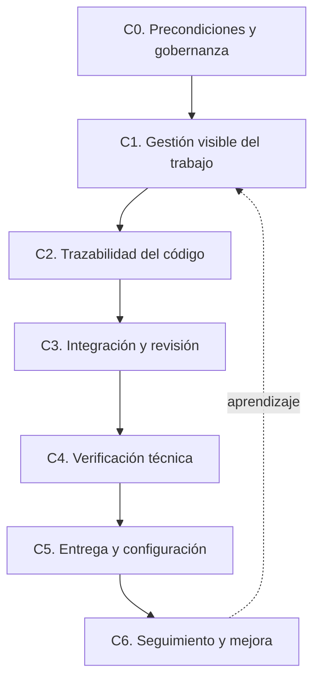

# ALSIE

## Tesis de Maestría en Ingeniería de Software

# Marco ligero progresivo de gestión técnica trazable en equipos pequeños de desarrollo con baja estandarización

**Autor:** Robert Cabrera Lara  
**Tutor:** Luis Roberto Pérez Rios, Ph.D.  
**Ciudad y país:** Santa Cruz, Bolivia  
**Mes y año de presentación:** noviembre de 2026

---

# Resumen

La investigación abordó la ausencia de una ruta común, ligera y verificable para la gestión técnica del trabajo de desarrollo en la línea de software a medida de PRX. El objeto de estudio fue un marco ligero progresivo de gestión técnica trazable, compuesto por precondiciones de gobernanza, gestión visible del trabajo, trazabilidad de código, integración de cambios, verificación técnica, entrega y seguimiento. Se empleó Design Science Research Methodology para diagnosticar la situación inicial, diseñar el artefacto, construir sus productos operativos y evaluarlo en una aplicación real. El diagnóstico combinó revisión de tareas, repositorios, ramas, commits y solicitudes de integración durante la ventana del 21 de septiembre al 4 de octubre de 2026. Los resultados mostraron prácticas heterogéneas, repositorios no institucionales, convenciones no documentadas y ausencia de evidencia mínima de verificación en las solicitudes observadas. La propuesta se instanció mediante estándares de ramas, commits y solicitudes de integración, una plantilla operativa y una estructura documental institucional. La evaluación formativa se realizó en la tarea CCC-7336 de Central API; produjo una cadena trazable desde la tarea hasta la fusión y evidenció 169 pruebas unitarias exitosas. Se ajustó la convención de ramas permanentes a `main`, `Stage` y `Production`. El resultado sumativo inicial se limitó a un caso y no permitió afirmar adopción sostenida ni mejora institucional. Se concluyó que el marco puede producir trazabilidad y evidencia técnica en un cambio real, bajo condiciones de contorno estrictas.

**Palabras clave:** gestión técnica, trazabilidad, Design Science, prácticas de desarrollo, equipos pequeños.

# Índice

1. [Introducción](#introducción)
2. [Capítulo I. Diagnóstico de la investigación](#capítulo-i-diagnóstico-de-la-investigación)
3. [Capítulo II. Marco teórico de la investigación](#capítulo-ii-marco-teórico-de-la-investigación)
4. [Capítulo III. Modelo teórico de la investigación](#capítulo-iii-modelo-teórico-de-la-investigación)
5. [Capítulo IV. Propuesta de la investigación](#capítulo-iv-propuesta-de-la-investigación)
6. [Conclusiones](#conclusiones)
7. [Recomendaciones](#recomendaciones)
8. [Referencias bibliográficas](#referencias-bibliográficas)
9. [Anexos](#anexos)

> Este archivo es la fuente en Markdown del informe. La paginación definitiva del índice se generará en la conversión institucional, sin modificar el contenido científico.

# Introducción

La Ingeniería de Software exige que el desarrollo no dependa exclusivamente de conocimientos individuales, especialmente cuando varios componentes, responsables y entregas deben coordinarse. En la línea de software a medida de PRX se observó una situación distinta a la de su línea consolidada de venta de servidores: las prácticas de desarrollo evolucionaron de forma desigual, con repositorios dispersos, registro irregular de tareas y evidencia técnica incompleta. La actualidad del estudio radica en que el crecimiento de una línea de software requiere prácticas mínimas que hagan visible el trabajo y permitan verificar los cambios sin imponer, desde el inicio, un modelo organizacional pesado.

La situación problemática afectó a un equipo pequeño que desarrolla sistemas para clientes y aplicaciones empresariales. Durante el diagnóstico se identificaron cambios no trazados, tareas con granularidad desigual, repositorios fuera de la organización institucional, convenciones no documentadas de ramas y commits, y solicitudes de integración sin evidencia mínima de verificación. Estas condiciones dificultaron la coordinación técnica, la inspección de los cambios y el respaldo de avances ante responsables internos o clientes.

El **problema científico** se formuló como la insuficiente evidencia situada sobre cómo diseñar un marco ligero de adopción inicial de prácticas de Ingeniería de Software para equipos pequeños de desarrollo con baja estandarización. La literatura ofrece estándares, marcos y prácticas de mejora; no obstante, se requiere conocimiento sobre su composición progresiva, verificable y ajustada a herramientas ya disponibles en contextos de baja formalización.

El **objeto de estudio** fue el marco ligero progresivo de gestión técnica trazable. Esta declaración resignifica el objeto conforme a Design Science: no se estudió a PRX como objeto, sino al artefacto construido para resolver una clase de problema. El **campo de acción** comprendió la adopción inicial de prácticas mínimas de gestión técnica en equipos pequeños de desarrollo con baja estandarización. La aplicación inicial se concentró en Central, formado por los componentes Odoo Backend, API y Frontend.

El **objetivo general** consistió en diseñar, construir y evaluar un marco ligero progresivo de gestión técnica trazable en equipos pequeños de desarrollo con baja estandarización, para mejorar la visibilidad del trabajo, la trazabilidad de cambios y la verificación técnica básica, y derivar principios de diseño aplicables a contextos similares.

Los objetivos específicos fueron:

1. Diagnosticar las prácticas de gestión visible, control de cambios, integración y verificación en la línea de software a medida de PRX.
2. Fundamentar el diseño del marco con teoría y soluciones existentes sobre mejora de procesos, gestión de configuración, transparencia, integración y pruebas.
3. Modelar los componentes y relaciones del marco ligero progresivo.
4. Construir e instanciar la propuesta en Central mediante reglas, estándares, plantilla y productos operativos.
5. Evaluar formativamente la aplicación del marco y registrar el rediseño correspondiente.
6. Obtener un resultado sumativo inicial de caso y formular conclusiones proporcionales a la evidencia.

Como hipótesis de trabajo, traducida desde la proposición de diseño de la investigación, se planteó que: si un marco ligero progresivo organiza prácticas mínimas mediante una cadena verificable de tarea, rama, commit, solicitud de integración y evidencia técnica, entonces puede mejorar la trazabilidad y la verificación de cambios en equipos pequeños con baja estandarización, porque transforma prácticas dispersas en acuerdos operativos observables.

El aporte teórico esperado fue un conjunto de principios de diseño candidatos para construir marcos ligeros de gestión técnica trazable. La significación práctica fue proporcionar a PRX un conjunto mínimo de productos operativos que permitan ordenar el trabajo técnico sin exigir una certificación de madurez ni automatización completa.

La investigación utilizó análisis-síntesis y modelación para estructurar el artefacto; revisión documental para caracterizar línea base y soluciones existentes; y análisis de caso para evaluar la aplicación en Central. La población de referencia estuvo compuesta por los componentes de software a medida de PRX observados en la línea base. La muestra intencional para la aplicación inicial fue Central y, específicamente, el caso CCC-7336 de Central API. La selección respondió a disponibilidad de una tarea real, repositorio, solicitud de integración y verificación técnica observable.

# Capítulo I. Diagnóstico de la investigación

## 1.1. Contexto de la investigación

PRX mantiene una línea consolidada de venta de servidores y un área de desarrollo con líneas diferenciadas de WordPress, Odoo y software a medida. La investigación no caracterizó a toda la empresa como pequeña o carente de procesos; se delimitó a la línea de software a medida, donde la coordinación técnica y la formalización de prácticas todavía eran heterogéneas. Central, Ansular y PConst aportaron evidencia diagnóstica; Central fue seleccionado como contexto de primera aplicación por integrar Odoo, una API y un frontend.

La configuración previa mostró que las herramientas existían, pero no operaban como un sistema común de gestión técnica. Odoo se utilizaba para algunas tareas y GitHub se empleaba en algunos componentes, aunque la visibilidad, el repositorio institucional y las reglas de trabajo dependían del proyecto o de la persona responsable. El problema, por tanto, no fue ausencia absoluta de tecnología sino falta de una ruta mínima común para usarla de manera verificable.

## 1.2. Operacionalización del diagnóstico

| Dimensión | Indicadores | Fuente principal |
|:--|:--|:--|
| Gestión visible del trabajo | I1. Tareas activas visibles y válidas | Odoo y revisión documental |
| Gobernanza de repositorios | I2. Componentes con repositorio institucional o excepción | GitHub y registro de componentes |
| Trazabilidad del código | I3. Ramas conformes; I4. commits conformes | GitHub |
| Integración y verificación | I5. cambios mediante solicitud; I6. solicitudes con evidencia; I7. verificación técnica | GitHub y resultado de pruebas |
| Evidencia de entregables | I9. Cadena tarea → rama → commit → solicitud → evidencia | Odoo, GitHub y evidencias privadas |

Los indicadores fueron definidos antes de construir el artefacto. I8, relativo a defectos o correcciones urgentes, se mantuvo como indicador contextual porque la ventana disponible no permitía inferir reducción de defectos con validez suficiente.

## 1.3. Resultados del diagnóstico

La línea base se levantó entre el 21 de septiembre y el 4 de octubre de 2026. Se observó que solo 3 de 7 componentes examinados estaban en la organización institucional de GitHub, equivalente a 42,86 %. Central API, Ansular Frontend y los componentes de PConst permanecían fuera de dicha organización. Esta condición reveló institucionalización incompleta de los repositorios, aunque no significó ausencia total de Git.

En la misma ventana, no existía una convención institucional documentada de ramas ni commits; por ello, I3 e I4 se registraron en 0 %. Se observaron cinco solicitudes de integración en componentes Odoo, pero ninguna incluía evidencia mínima de verificación, por lo que I6 fue 0 de 5. En Central API se reportó trabajo realizado que no fue subido al repositorio durante la ventana; allí no se registraron ramas, commits ni solicitudes de integración observables. Esta diferencia confirmó que el problema no se reduce a abrir solicitudes de integración, sino a hacer trazable el trabajo y asociarlo con evidencia técnica.

| Indicador | Línea base | Lectura diagnóstica |
|:--|:--|:--|
| I1 | Parcial | Existían tareas visibles, pero con granularidad desigual e información incompleta en componentes Odoo. |
| I2 | 3 de 7 componentes institucionales | La gobernanza de repositorios era incompleta. |
| I3 | 0 % | No existía convención documentada de ramas. |
| I4 | 0 % | No existía convención documentada de commits. |
| I5 | 5 de 5 cambios observables | Había solicitudes en Odoo, pero no homogeneidad ni revisión independiente demostrada. |
| I6 | 0 de 5 solicitudes | No se observó evidencia mínima de verificación. |
| I7 | Parcial | Había capacidades de prueba heterogéneas, sin evidencia ejecutada asociada a Central API. |
| I9 | Parcial | La cadena completa existía solo de forma aislada o histórica. |

La tendencia diagnóstica fue una adopción parcial y dependiente de personas. PConst mostró una tarea amplia que agrupaba varios componentes y actividades; Central Frontend contenía evidencia histórica de una práctica local más trazable; Central API presentaba trabajo no trazado durante la ventana. En conjunto, los datos justificaron un marco que priorice trazabilidad mínima antes que automatización compleja.

## 1.4. Conclusiones del diagnóstico

El diagnóstico permitió inferir tres regularidades. Primero, la disponibilidad de Odoo y GitHub no garantizaba gestión técnica verificable. Segundo, las prácticas existentes no constituían un estándar institucional común, pues variaban por componente y responsable. Tercero, la ausencia de evidencia de verificación en solicitudes y de trazabilidad en Central API justificó diseñar una cadena mínima observable. Estas regularidades definieron los requisitos del artefacto y evitaron convertir la investigación en una evaluación general de calidad de código o madurez CMMI.

# Capítulo II. Marco teórico de la investigación

## 2.1. Mejora de procesos y entidades de capacidad reducida

ISO/IEC 29110 fue adoptada como referencia para justificar una mejora gradual en equipos con recursos y capacidad de adopción limitados. La norma está dirigida a entidades muy pequeñas y sostiene el uso de perfiles y guías ajustados a sus condiciones reales (International Organization for Standardization [ISO] & International Electrotechnical Commission [IEC], 2024a). Pino et al. (2008) también evidenciaron que la mejora de procesos en empresas pequeñas requiere adaptación a restricciones de tamaño y recursos. En consecuencia, la investigación no propuso una implantación completa de madurez, sino una ruta mínima de alto impacto.

La tensión relevante es que una estructura de control extensa puede aumentar la evidencia disponible y, al mismo tiempo, hacer inviable la adopción inicial. Laporte et al. (2018) vincularon la aplicación de estándares con trayectorias de crecimiento de entidades pequeñas, pero esa trayectoria no autoriza a afirmar certificación ni madurez formal en PRX. El marco se posicionó como un paso de profesionalización técnica, no como sustituto de ISO/IEC 29110 o CMMI.

## 2.2. Fundamentos de Ingeniería de Software y transparencia del trabajo

SWEBOK ubica las prácticas seleccionadas en áreas reconocidas de Ingeniería de Software: gestión de configuración, proceso de software, gestión, pruebas y calidad (Washizaki, 2024). Esta relación impidió que el marco se fundamente en preferencias individuales. La exigencia de repositorio o excepción se vinculó con gestión de configuración; las tareas visibles con gestión de Ingeniería de Software; y la evidencia de pruebas con calidad y pruebas.

Los principios de transparencia, inspección y adaptación de Scrum fundamentaron la exigencia de hacer visible el trabajo, sin adoptar Scrum como método completo (Schwaber & Sutherland, 2020). El marco no reemplazó Odoo ni impuso ceremonias ágiles; exigió que la tarea contenga información suficiente para vincular la necesidad con el cambio técnico y su verificación.

## 2.3. Trazabilidad de cambios y verificación técnica

GitHub Flow describe un flujo ligero basado en ramas, commits y solicitudes de integración hacia una rama principal (GitHub Docs, s. f.). La investigación tomó estos elementos como principios operativos y los adaptó a la situación de PRX mediante nombres de ramas, códigos de tarea, plantilla de solicitud y validación progresiva. El objetivo no fue replicar un flujo corporativo completo, sino reducir ambigüedad mediante ramas cortas, integración frecuente y eliminación de ramas temporales después de la fusión.

Aniche (2022) fundamentó la decisión de exigir verificación mínima en vez de cobertura total. La primera versión del marco solicitó una prueba unitaria, construcción, prueba de API o verificación documentada en un componente crítico. Buchalcevova (2021) mostró que la calidad y las pruebas requieren atención explícita incluso en perfiles básicos de ISO/IEC 29110; por ello, la verificación no se dejó como consecuencia implícita de usar solicitudes de integración.

## 2.4. Estado del arte y posición de la investigación

ISO/IEC 29110, CMMI, Scrum, GitHub Flow y las solicitudes de integración resuelven partes del problema, pero ninguna solución ofrece por sí sola una ruta ligera, contextualizada y evaluable para el caso de PRX. CMMI se utilizó solo como antecedente conceptual, pues una evaluación de niveles de madurez excede el alcance de esta tesis (CMMI Institute, s. f.). GitHub Flow proporciona trazabilidad de cambios, pero no regula tareas visibles ni evidencia técnica; Scrum favorece transparencia, pero su implantación completa no era necesaria ni evaluable en el periodo disponible.

La novedad relativa del marco reside en componer estas piezas como productos de trabajo mínimos: tarea válida, repositorio o excepción, rama y commit trazables, solicitud con plantilla, evidencia técnica, registro de entrega y seguimiento. Esta composición se dirige a equipos pequeños de desarrollo con baja estandarización y se evalúa mediante evidencia de campo, no mediante una promesa abstracta de mejora.

## 2.5. Conclusiones del marco teórico

La teoría sustenta que un marco ligero debe ser progresivo, apoyarse en prácticas reconocidas y explicitar evidencia verificable. También justifica la decisión de no imponer automatización completa, certificación o revisión independiente obligatoria cuando las condiciones del equipo no la permiten. La posición asumida integra transparencia, gestión de configuración, trazabilidad y verificación como mecanismos complementarios de gestión técnica.

# Capítulo III. Modelo teórico de la investigación

## 3.1. Fundamentación del modelo

El modelo teórico representa el marco como un sistema de componentes relacionados que transforma prácticas dispersas en una cadena mínima de gestión técnica trazable. Su fundamento epistemológico es prescriptivo: el conocimiento se genera al diseñar, construir y evaluar un artefacto que busca cambiar una situación problemática, conforme a Design Science (Hevner et al., 2004; Peffers et al., 2007).

La unidad modelada es el artefacto, no el proceso existente de PRX. Sus relaciones se ordenan de forma secuencial: la gobernanza mínima habilita tareas visibles; las tareas dan contexto a la trazabilidad de código; la trazabilidad permite solicitudes de integración informadas; estas hacen verificable el cambio; y el seguimiento retroalimenta la mejora del marco.

## 3.2. Componentes y relaciones esenciales

| Componente | Relación esencial | Producto observable |
|:--|:--|:--|
| C0. Precondiciones y gobernanza | Define responsable, repositorio o excepción y herramienta de tareas. | Ficha de componente. |
| C1. Gestión visible | Convierte una necesidad en tarea con responsable, componente y criterio de terminado. | Tarea válida. |
| C2. Trazabilidad del código | Relaciona tarea, rama y commit mediante el código de tarea. | Historial Git conforme. |
| C3. Integración y revisión | Concentra descripción, riesgo, verificación y validación del cambio. | Solicitud de integración válida. |
| C4. Verificación técnica | Aporta evidencia de que el cambio fue comprobado. | Resultado de prueba, construcción o prueba de API. |
| C5. Entrega y configuración | Relaciona versión o rama con ambiente, fecha y responsable. | Registro mínimo de entrega. |
| C6. Seguimiento y mejora | Usa indicadores, excepciones y hallazgos para ajustar el marco. | Informe de adopción y rediseño. |

La regularidad propuesta es que la trazabilidad útil no se obtiene con un único control. Requiere que cada producto de trabajo preserve el vínculo con el anterior. Cuando una tarea no es visible, la rama carece de contexto; cuando la solicitud no incluye verificación, la fusión no acredita que el cambio fue comprobado. Esta relación explica por qué el artefacto integra componentes de método, reglas, plantillas e indicadores.

## 3.3. Principios de diseño candidatos

1. Para reducir ambigüedad operativa, el marco debe exigir una cadena mínima tarea → rama → commit → solicitud → evidencia, porque una cadena corta es inspeccionable sin imponer burocracia extensa.
2. Para iniciar adopción en equipos con prácticas heterogéneas, el marco debe formalizar reglas y productos observables antes de automatizar controles, porque la automatización prematura puede ocultar falta de comprensión compartida.
3. Para evitar que una plantilla sea confundida con una regla completa, el marco debe diferenciar estándar institucional y plantilla operativa, porque título, excepciones y validación requieren reglas que una plantilla no controla por sí sola.
4. Para introducir control cuando no existe disponibilidad continua de revisores, el marco debe distinguir auto-validación documentada, revisión por tercero, validación automática y excepción, porque exigir una revisión inexistente produciría cumplimiento ficticio.
5. Para reducir el riesgo de cambios no comprobados, el marco debe exigir evidencia técnica mínima asociada a cada solicitud, porque la integración sin prueba no permite distinguir entre cambio realizado y cambio verificado.

## 3.4. Conclusiones del modelo

El modelo integra prácticas existentes en una estructura original para el contexto delimitado. Su valor no reside en inventar ramas, pruebas o solicitudes de integración, sino en definir cómo se relacionan, qué evidencia producen y bajo qué condiciones pueden aplicarse progresivamente. El modelo se concreta en la propuesta del capítulo siguiente.

# Capítulo IV. Propuesta de la investigación

## 4.1. Denominación, objetivo y estructura

La propuesta se denomina **Marco ligero progresivo para la gestión técnica trazable del trabajo de desarrollo en equipos pequeños con baja estandarización**. Su objetivo es establecer una ruta mínima, gradual y verificable para que los cambios de software produzcan evidencia desde la tarea hasta la integración y verificación.

La estructura se apoya en la lógica de perfiles adaptados para entidades pequeñas de ISO/IEC 29110, en principios de transparencia e inspección de Scrum y en prácticas de gestión de configuración y pruebas reconocidas por SWEBOK. No replica estas fuentes como proceso completo; las adapta al contexto de aplicación, de acuerdo con las restricciones observadas (ISO & IEC, 2024a; Schwaber & Sutherland, 2020; Washizaki, 2024).

## 4.2. Reglas operativas

| Regla | Contenido mínimo |
|:--|:--|
| Tarea válida | Descripción, responsable, componente, criterio de aceptación, estado y criterio de terminado. |
| Repositorio o excepción | Cada componente declara repositorio institucional, de cliente, tercero o excepción justificada. |
| Ramas permanentes | `main` como tronco; `Stage` para validación y `Production` para producción, solo cuando existan ambientes correspondientes. |
| Rama temporal | `<tipo>/<codigo-tarea>-<descripcion-corta>`. |
| Commit trazable | `<tipo>(<codigo-tarea>): <descripcion breve>`. |
| Solicitud válida | Título trazable y plantilla con tarea, cambio, riesgo, verificación, evidencia y validación. |
| Verificación técnica | Prueba unitaria, construcción, prueba de API, prueba de integración, prueba manual documentada o justificación. |
| Entrega | Ambiente, rama o versión, fecha, responsable y mecanismo de despliegue. |

Los tipos iniciales de rama y commit son `feat`, `fix`, `hotfix`, `config`, `test`, `docs` y `refactor`. Las ramas temporales parten de `main`; después de la solicitud de integración se fusionan hacia `main` y se eliminan cuando corresponda. `Stage` y `Production` son ramas de promoción o ambiente, no espacios de desarrollo directo.

## 4.3. Productos construidos e instanciación

La propuesta produjo los estándares `STD-GIT-001` para ramas, `STD-GIT-002` para solicitudes de integración y `STD-GIT-003` para commits. También produjo una plantilla operativa de solicitud de integración y una estructura documental en SharePoint. La actualización V1.1 de `STD-GIT-001` formalizó las denominaciones `main`, `Stage` y `Production`, alineando el estándar con configuraciones históricas observadas sin atribuir dichas configuraciones previas al artefacto.

En PRX, la instanciación se realizó mediante Odoo para tareas, GitHub para código y solicitudes de integración, SharePoint para estándares y el repositorio organizacional `.github` para distribuir la plantilla. El artefacto permanece agnóstico de herramienta: otro contexto podría reemplazar esas instanciaciones por productos equivalentes en GitLab, Azure DevOps u otra plataforma.

## 4.4. Aplicación y evaluación inicial

La aplicación formativa se realizó en la tarea `CCC-7336`, correspondiente a la validación de pruebas unitarias en Central API. Se creó la rama `test/CCC-7336-validar-tests-unitarios-api`, se registró un commit con código de tarea y se abrió una solicitud de integración con plantilla. La solicitud fue fusionada y la rama temporal fue eliminada. La ejecución de pruebas mostró 169 pruebas unitarias exitosas.

| Evidencia privada | Hecho respaldado |
|:--|:--|
| `E-ODOO-INT-01` | Tarea real `CCC-7336`. |
| `E-GH-INT-01` | Rama, commit, título y plantilla de la solicitud. |
| `E-GH-INT-02` | Fusión y eliminación de rama temporal. |
| `E-GH-INT-04` | Configuración de `main`, `Stage`, `Production` y retiro de `master` en el repositorio intervenido. |
| `E-TEST-INT-01` | Ejecución exitosa de 169 pruebas unitarias. |
| `E-ORG-INT-06` | Publicación de `STD-GIT-001` V1.1. |

No se reportaron fricciones operativas durante el caso. El rediseño V1.1 respondió a un ajuste contextual de nombres de ramas permanentes y no a una falla del uso de `CCC-7336`. La evaluación sumativa inicial comparó Central API antes y después del caso: en la línea base no se registraron ramas, commits ni solicitudes de integración para ese componente; en el caso posterior se obtuvo una cadena completa. La comparación demuestra aplicabilidad inicial, no adopción sostenida, porque su unidad de análisis fue un único cambio y el ejecutor coincidió con el constructor del artefacto.

## 4.5. Evaluación de la propuesta

La propuesta fue evaluada con una estrategia formativa y un resultado sumativo inicial de caso. La utilidad observada fue que el marco permitió relacionar una tarea real con rama, commit, solicitud, prueba, fusión y eliminación de rama. I7 se cumplió para Central API mediante 169 pruebas unitarias exitosas. I2 no se declaró cumplido porque la migración del repositorio a la organización institucional seguía pendiente; el marco exige registrar esta condición como excepción durante la transición.

La evaluación presenta limitaciones: un solo cambio posterior, ausencia de periodo equivalente a la línea base, coincidencia entre autor y ejecutor y evidencia técnica asociada externamente a la descripción inicial de la solicitud. Estas limitaciones impiden calcular porcentajes de adopción o afirmar mejora sostenida. La evaluación sustenta una demostración de viabilidad del marco en un caso real.

## 4.6. Conclusiones de la propuesta

La propuesta concretó el modelo teórico en productos reproducibles y reglas aplicables. Su primera aplicación mostró que la cadena mínima puede ejecutarse sin fricción operativa reportada en Central API. La propuesta no sustituye una estrategia completa de calidad, gobierno de repositorios ni entrega continua; establece un punto de partida verificable para su adopción progresiva.

# Conclusiones

1. El diagnóstico mostró que la situación de PRX no era ausencia de herramientas, sino prácticas técnicas parciales, heterogéneas y dependientes de personas. La línea base justificó un artefacto orientado a trazabilidad y verificación mínima, no una implantación completa de madurez.

2. El marco teórico permitió fundamentar un diseño ligero y progresivo. ISO/IEC 29110, SWEBOK, Scrum, GitHub Flow y la literatura sobre pruebas sustentaron decisiones específicas del artefacto, evitando que sus reglas fueran preferencias aisladas.

3. El modelo teórico integró seis componentes relacionados: precondiciones, gestión visible, trazabilidad de código, integración, verificación, entrega y mejora. La relación tarea → rama → commit → solicitud → evidencia constituye el mecanismo central de trazabilidad.

4. La propuesta produjo estándares, plantilla, estructura documental y una instanciación técnica que permitieron aplicar el marco en `CCC-7336`. El caso generó tarea trazable, rama y commit conformes, solicitud fusionada, eliminación de rama y 169 pruebas unitarias exitosas.

5. El resultado sumativo inicial de caso mostró aplicabilidad en Central API, pero no permite afirmar adopción sostenida, efectividad del equipo ni generalización estadística. Los principios de diseño permanecen como candidatos con transferibilidad analítica limitada a equipos pequeños o áreas de software con condiciones comparables.

# Recomendaciones

1. Aplicar el marco en nuevos cambios de Central y registrar un periodo posterior comparable con la línea base para estimar tasas de conformidad y evidencia mínima.

2. Documentar la excepción de repositorios no institucionales y planificar su migración de manera gradual, sin interrumpir despliegues ni automatizaciones existentes.

3. Incorporar participación de responsables distintos del constructor del marco para evaluar claridad, aplicabilidad y revisión independiente cuando sea factible.

4. Vincular explícitamente la evidencia final de pruebas dentro de cada solicitud de integración futura, de modo que la plantilla y la evidencia técnica permanezcan unidas en el mismo registro.

5. Evaluar en investigaciones posteriores la aplicación del marco en otros equipos o contextos, con periodos más extensos y condiciones de despliegue distintas.

# Referencias bibliográficas

Aniche, M. (2022). *Effective software testing: A developer's guide*. Manning Publications. https://www.manning.com/books/effective-software-testing

Buchalcevova, A. (2021). Towards higher software quality in very small entities: ISO/IEC 29110 software basic profile mapping to testing standards. *International Journal of Information Technologies and Systems Approach, 14*(1), 79–96. https://doi.org/10.4018/IJITSA.2021010105

CMMI Institute. (s. f.). *CMMI Model Viewer*. ISACA. Recuperado el 22 de septiembre de 2026, de https://cmmiinstitute.com/cmmi/model-viewer/

GitHub Docs. (s. f.). *GitHub flow*. Recuperado el 22 de septiembre de 2026, de https://docs.github.com/en/get-started/using-github/github-flow

Hevner, A. R., March, S. T., Park, J., & Ram, S. (2004). Design science in information systems research. *MIS Quarterly, 28*(1), 75–106. https://doi.org/10.2307/25148625

International Organization for Standardization, & International Electrotechnical Commission. (2024a). *ISO/IEC 29110-1-1:2024: Systems and software engineering — Lifecycle profiles for very small entities (VSEs) — Part 1-1: Overview*. https://www.iso.org/standard/85337.html

Laporte, C. Y., Munoz, M., Mejia Miranda, J., & OConnor, R. V. (2018). Applying software engineering standards in very small entities: From startups to grownups. *IEEE Software, 35*(1), 99–103. https://doi.org/10.1109/MS.2017.4541041

Peffers, K., Tuunanen, T., Rothenberger, M. A., & Chatterjee, S. (2007). A design science research methodology for information systems research. *Journal of Management Information Systems, 24*(3), 45–77. https://doi.org/10.2753/MIS0742-1222240302

Pino, F. J., García, F., & Piattini, M. (2008). Software process improvement in small and medium software enterprises: A systematic review. *Software Quality Journal, 16*(2), 237–261. https://doi.org/10.1007/s11219-007-9038-z

Schwaber, K., & Sutherland, J. (2020). *The Scrum Guide: The definitive guide to Scrum: The rules of the game*. https://scrumguides.org/scrum-guide.html

Washizaki, H. (Ed.). (2024). *Guide to the Software Engineering Body of Knowledge (SWEBOK Guide), Version 4.0*. IEEE Computer Society. https://www.computer.org/education/bodies-of-knowledge/software-engineering

# Anexos

## Anexo 1. Matriz de indicadores

Los indicadores I1 a I9, sus definiciones operacionales, fuentes y línea base se encuentran en `tesis_ds/06_consolidacion_indicadores.md`. En la versión entregable se incorporará la tabla anonimizada correspondiente.

## Anexo 2. Instrumentos de diagnóstico

Las fichas de revisión de tareas, repositorios, pruebas y entrevistas se encuentran en `tesis_ds/06_instrumentos_linea_base.md` y `tesis_ds/06_guia_recoleccion_linea_base.md`.

## Anexo 3. Ficha reproducible del artefacto

La descripción completa de componentes C0-C6, reglas, productos e instrucciones de aplicación se encuentra en `tesis_ds/07f_ficha_artefacto.md`.

## Anexo 4. Estándares y plantilla operativa

Los estándares `STD-GIT-001`, `STD-GIT-002`, `STD-GIT-003`, la enmienda V1.1 y la plantilla operativa de solicitud de integración se conservan como anexos privados y productos institucionales. Las evidencias públicas deben usar códigos y ocultar nombres, enlaces privados, teléfonos, clientes y código sensible.

## Anexo 5. Evidencias de aplicación y evaluación

La relación de evidencias privadas se registra en `tesis_ds/06_plan_evidencias_privadas.md`. Los resultados de aplicación formativa y sumativa inicial de caso se documentan en `tesis_ds/08_registro_formativo_CCC-7336.md` y `tesis_ds/08_resultado_sumativo_inicial_CCC-7336.md`.
