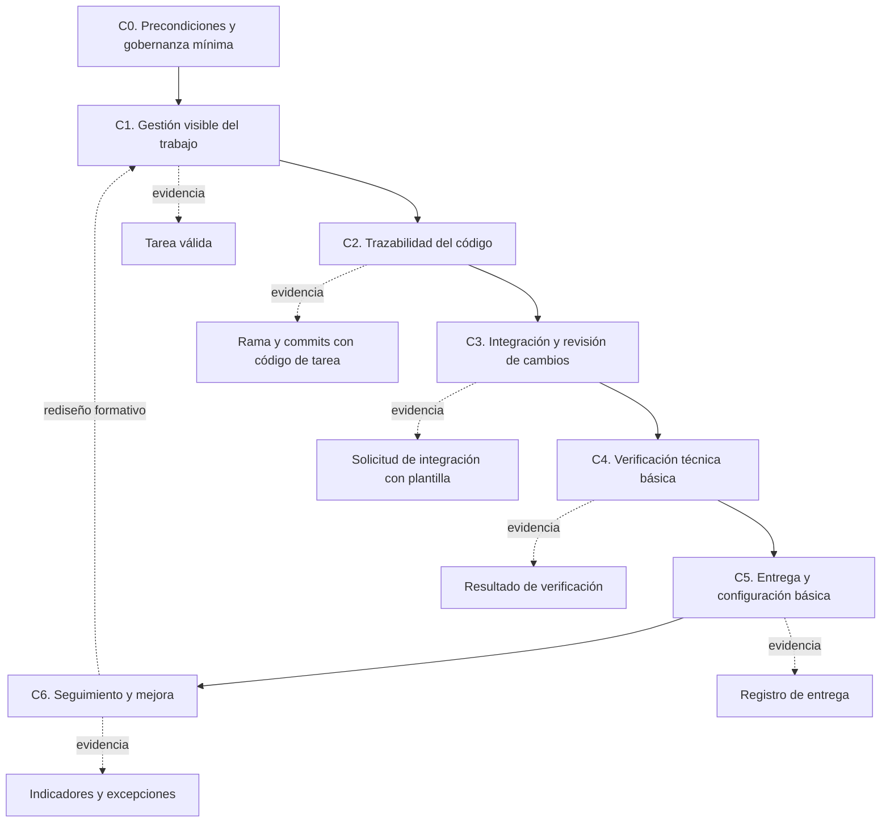

# E7c. Diseño del artefacto

## Propósito

Este documento formaliza el diseño de la primera versión del **Marco ligero progresivo para la gestión técnica trazable del trabajo de desarrollo en equipos pequeños con baja estandarización**. El artefacto es un **marco** con componentes de método, plantillas operativas, reglas mínimas, indicadores y niveles de adopción. La instanciación inicial se realizará en PRX, dentro del proyecto Central, pero el diseño evita depender exclusivamente de Odoo o GitHub.

En Design Science, el artefacto no se evalúa solo porque “funcione” en una organización; debe mostrar qué decisiones de diseño responden al problema identificado y qué conocimiento puede transferirse analíticamente a una clase de contextos. Por ello, este diseño documenta componentes, reglas, decisiones, alternativas descartadas y trazabilidad hacia los requisitos definidos en E7b.

## Tipo de artefacto y alcance

| Elemento | Definición para esta tesis |
|:--|:--|
| Tipo principal | Marco. |
| Componentes internos | Método operativo mínimo, plantillas, reglas, niveles de adopción e indicadores. |
| Exemplar de aplicación | Proyecto Central de PRX: Central Odoo Backend, Central API y Central Frontend. |
| Clase de contextos | Equipos pequeños de desarrollo de software con baja estandarización, prácticas parcialmente existentes y necesidad de evidencia trazable. |
| Herramientas en PRX | Odoo para tareas y GitHub para repositorios, ramas, commits y solicitudes de integración. |
| Herramientas equivalentes | Jira, Trello, GitLab, Azure DevOps u otras herramientas que permitan registrar tareas, cambios y evidencias. |

El diseño se apoya en la tipología de artefactos de Design Science, donde un marco integra constructos, modelos y métodos para abordar una clase de problemas, y su evaluación debe considerar cobertura, coherencia y aplicabilidad con practicantes reales (Hevner et al., 2004; March & Smith, 1995; Wieringa, 2014). En esta tesis, el marco no reemplaza la gestión completa de proyectos ni pretende certificar procesos; su alcance es establecer una ruta mínima y verificable para que el trabajo técnico deje evidencia trazable.

## Problema de diseño que resuelve

PRX tiene prácticas técnicas parciales, pero no homogéneas ni institucionalizadas. La línea base muestra repositorios dispersos, ausencia de convención documentada de ramas y commits, solicitudes de integración sin evidencia mínima de verificación, ramas permanentes con nombres heterogéneos y tareas de granularidad excesiva. El marco busca resolver este problema mediante reglas mínimas, productos de trabajo observables y niveles de adopción progresiva.

El problema de investigación —que en el formato institucional se registrará como problema científico— no es “cómo configurar GitHub”, sino cómo diseñar un marco ligero de adopción inicial de prácticas de Ingeniería de Software que produzca trazabilidad y evidencia verificable en equipos pequeños con baja estandarización.

## Principios de diseño aplicados en la versión 1

| Principio | Aplicación en el diseño |
|:--|:--|
| Ligereza | Solo se exigen campos y reglas necesarios para visibilidad, trazabilidad y verificación básica. |
| Progresividad | El marco permite avanzar desde solicitud trazable hasta revisión por tercero, sin fingir madurez inexistente. |
| Verificabilidad | Cada regla debe producir una evidencia observable: tarea, rama, commit, solicitud, captura, registro o resultado de prueba. |
| Agnosticismo de herramienta | El marco define productos de trabajo; Odoo y GitHub son la instanciación PRX. |
| Trazabilidad bidireccional | Debe poder recorrerse tarea → rama → commit → solicitud de integración → evidencia, y también en sentido inverso. |
| Responsabilidad mínima | Cada tarea, repositorio, excepción, validación y entrega debe tener responsable explícito. |

Estos principios conectan el diseño con la base de conocimiento sobre adaptación de prácticas a entidades pequeñas y muy pequeñas, mejora gradual de procesos y transparencia del trabajo (International Organization for Standardization & International Electrotechnical Commission, 2024a; Laporte et al., 2018; Pino et al., 2008; Schwaber & Sutherland, 2020). La tensión principal es que mayor control produce más evidencia, pero también más fricción; por eso el diseño prioriza reglas mínimas antes que automatización completa.

## Estructura general del marco



El marco se organiza como una cadena de prácticas. Si una tarea no es visible, no se puede exigir trazabilidad técnica confiable; si no hay trazabilidad técnica, la solicitud de integración pierde contexto; si la solicitud no documenta verificación, la entrega no produce evidencia defendible. Esta secuencia evita convertir el marco en una lista desordenada de buenas prácticas.

## Componentes del artefacto

| Componente | Objetivo | Regla mínima | Producto de trabajo | Evidencia esperada |
|:--|:--|:--|:--|:--|
| C0. Precondiciones y gobernanza mínima | Asegurar que el equipo tenga condiciones mínimas para aplicar el marco. | Todo componente debe tener repositorio oficial o excepción documentada, responsable técnico y mecanismo de gestión de tareas. | Ficha de componente. | Repositorio identificado, responsable codificado y excepción si aplica. |
| C1. Gestión visible del trabajo | Evitar trabajo técnico invisible o tareas demasiado amplias. | Toda tarea debe tener descripción, responsable, componente, criterio de aceptación, estado y criterio de terminado. | Tarea válida. | Registro en Odoo o herramienta equivalente. |
| C2. Trazabilidad del código | Vincular cambios técnicos con tareas. | Toda rama temporal y commit relevante debe incluir código de tarea. | Rama y commits trazables. | Historial Git y convención cumplida. |
| C3. Integración y revisión de cambios | Estandarizar la solicitud de integración como punto de control. | Toda solicitud debe usar plantilla mínima y declarar tipo, riesgo, componentes, verificación y validación. | Solicitud de integración válida. | Plantilla completada en GitHub o equivalente. |
| C4. Verificación técnica básica | Evitar entregas sin evidencia de prueba o comprobación. | Cada cambio funcional debe declarar método de verificación y evidencia. | Registro de verificación. | Prueba ejecutada, captura, salida de comando, revisión manual documentada o justificación. |
| C5. Entrega y configuración básica | Saber qué versión llegó a qué ambiente. | Toda entrega relevante debe registrar ambiente, rama o versión, fecha, responsable y mecanismo. | Registro mínimo de entrega. | Registro de despliegue, etiqueta, rama o evidencia de ambiente. |
| C6. Seguimiento y mejora | Medir adopción y ajustar el marco. | Registrar indicadores, incumplimientos, excepciones y cambios de diseño. | Informe de adopción. | Matriz de indicadores y bitácora de rediseño. |

## Reglas operativas de la versión 1

### R1. Tarea válida

Una tarea se considera válida cuando contiene, como mínimo: descripción, responsable, componente afectado, criterio de aceptación, estado y criterio de terminado. Si una tarea agrupa objetivos independientes, componentes distintos o verificaciones no relacionadas, debe dividirse. Esta regla responde a la evidencia de tareas amplias que dificultan saber qué cambio técnico corresponde a qué necesidad.

### R2. Repositorio oficial o excepción documentada

Cada componente debe clasificarse como repositorio institucional, repositorio del cliente, repositorio de tercero o excepción documentada. La regla no exige migrar inmediatamente todos los repositorios, porque eso puede introducir riesgo operativo; exige que la condición sea explícita, fechada y justificada.

### R3. Ramas permanentes oficiales

Cada repositorio debe declarar su rama por defecto, su rama de validación y su rama de producción si aplica. Para PRX, el estándar objetivo es `main` como rama por defecto y tronco de integración, `stage` como rama de validación cuando exista ambiente de pruebas, y `production` solo cuando el mecanismo de despliegue requiera una rama separada de producción.

La normalización debe ser progresiva. En repositorios históricos con ramas como `Production`, `Prod`, `Staging`, `TEST` o `test`, primero se documenta la equivalencia y luego se planifica la normalización. No se debe renombrar una rama sin verificar dependencias de despliegue, automatizaciones, Odoo.sh u otros mecanismos que dependan del nombre actual.

### R4. Ramas temporales de trabajo

Las ramas temporales de trabajo deben seguir el formato:

```text
<tipo>/<codigo-tarea>-<descripcion-corta>
```

Ejemplos:

```text
feat/CCC-4407-operador-contrato
fix/CCC-4900-aviso-cancelacion
hotfix/CCC-4912-error-produccion
config/CCC-4420-ajustar-variables-entorno
test/CCC-4430-pruebas-contratos
docs/CCC-4431-actualizar-readme
refactor/CCC-4432-separar-servicio-contratos
```

### R5. Commits trazables

Los commits relevantes deben seguir el formato:

```text
<tipo>(<codigo-tarea>): <descripcion breve>
```

Ejemplo:

```text
feat(CCC-4407): agregar datos del operador en contratos
```

Los tipos iniciales permitidos son `feat`, `fix`, `hotfix`, `config`, `test`, `docs` y `refactor`. Tipos como `chore`, `perf`, `build`, `ci`, `revert` y `release` quedan como ampliaciones posteriores, porque introducir demasiados tipos en la primera versión aumenta fricción y reduce adopción.

### R6. Flujo basado en tronco

El marco adopta un flujo basado en tronco inspirado en *Trunk-Based Development* —desarrollo basado en tronco—, con ramas cortas por tarea, solicitud de integración, fusión por `squash merge` cuando sea apropiado y eliminación de la rama después de fusionar. `main` es el tronco de integración; `stage` y `production` son ramas de promoción o ambiente, no ramas donde se desarrolla directamente.

Flujo recomendado para PRX:

```text
rama temporal de tarea → solicitud de integración → main → stage → production
```

### R7. Solicitud de integración válida

Una solicitud de integración válida debe usar la plantilla mínima definida en `tesis_ds/07c_plantilla_solicitud_integracion.md`. En PRX, la instanciación recomendada es el archivo `.github/pull_request_template.md` dentro del repositorio organizacional `.github`, para que la plantilla se aplique por defecto en la organización.

La plantilla es parte del artefacto, no un anexo decorativo. En el cuerpo de la tesis se describe y justifica; como anexo operativo se presenta completa. Su función es operacionalizar trazabilidad, verificación y validación mínima.

La validación automática del llenado de la plantilla mediante un flujo de trabajo de GitHub Actions puede incorporarse como mejora posterior de la instanciación PRX. No se define como requisito obligatorio de la versión 1 del marco, porque el criterio inicial es lograr uso observable de la plantilla y evidencia mínima en solicitudes de integración; la automatización debe agregarse solo si no desplaza la evaluación formativa ni introduce sobrecarga técnica innecesaria.

### R8. Validación progresiva

El marco distingue cuatro estados de validación: solicitud trazable, plantilla completa, auto-validación documentada y revisión por una persona distinta del autor. En componentes con un solo desarrollador, la auto-validación documentada se acepta como excepción explícita, no como revisión independiente. Esta decisión evita declarar una práctica inexistente y permite medir progreso real.

### R9. Verificación técnica básica

Cada cambio funcional debe declarar qué se verificó, cómo se verificó y con qué evidencia. La evidencia puede ser prueba unitaria, prueba de integración, prueba manual documentada, salida de construcción, ejecución de API, captura contextualizada o justificación de no aplicabilidad. Al menos un componente crítico de Central deberá incorporar prueba unitaria ejecutable o evidencia técnica equivalente justificada.

### R10. Registro mínimo de entrega

Cada entrega relevante debe registrar ambiente, rama o versión, fecha, responsable y mecanismo de despliegue. Esta regla conecta la trazabilidad técnica con la evidencia de entrega ante clientes o responsables internos.

## Niveles de adopción

Los niveles no son un modelo de madurez ni una versión reducida de CMMI. Funcionan como una escala operativa para medir avance en la adopción del marco.

| Nivel | Nombre | Condición mínima |
|:--|:--|:--|
| 0 | No estructurado | Trabajo sin prácticas mínimas consistentes o evidencia dispersa. |
| 1 | Visible | Tareas y repositorios identificables. |
| 2 | Trazable | Relación observable tarea ↔ rama ↔ commit. |
| 3 | Integrado | Cambios integrados mediante solicitud de integración con plantilla. |
| 4 | Verificado | Solicitudes con evidencia mínima de verificación técnica. |
| 5 | Entregable trazable | Entregas con ambiente, versión, responsable, fecha y mecanismo registrados. |

La primera aplicación en Central no tiene que alcanzar todos los niveles en todos los componentes. El criterio de diseño es observar adopción progresiva y documentar fricciones, excepciones y rediseños.

## Trazabilidad requisito → componente → decisión

| Requisito | Componente | Decisión de diseño | Justificación |
|:--|:--|:--|:--|
| RQ1 | C0 | Exigir ficha mínima de componente. | Sin repositorio, responsable y mecanismo de excepción, el marco no puede aplicarse con evidencia. |
| RQ2 | C1 | Definir tarea válida. | La trazabilidad técnica requiere una unidad de trabajo suficientemente clara. |
| RQ3 | C1 | Incorporar criterio de división. | Los tickets amplios impiden verificar cumplimiento por cambio. |
| RQ4 | C0 | Clasificar repositorio oficial o excepción. | La línea base mostró componentes fuera de la organización institucional. |
| RQ5 | C2 | Usar formato `<tipo>/<codigo-tarea>-<descripcion-corta>`. | La rama debe vincular el cambio con la tarea desde su creación. |
| RQ5.1 | C2 y C5 | Declarar ramas permanentes y equivalencias. | La ausencia o variación de `main`, `stage` y `production` debilita trazabilidad de ambientes. |
| RQ6 | C2 | Usar formato `<tipo>(<codigo-tarea>): <descripcion breve>`. | El commit debe conservar trazabilidad aunque la rama sea eliminada. |
| RQ6.1 | C2 y C3 | Adoptar flujo basado en tronco. | GitFlow introduce sobrecarga innecesaria para la aplicación inicial. |
| RQ7 | C3 | Usar plantilla mínima de solicitud de integración. | La solicitud se convierte en punto de control verificable. |
| RQ8 | C3 | Separar auto-validación, validación automática y revisión independiente. | Evita fingir revisión por pares donde no existe disponibilidad real. |
| RQ9 | C3 | Diseñar validación progresiva. | Permite mejorar sin bloquear equipos pequeños con un solo responsable. |
| RQ10 | C4 | Exigir método y evidencia de verificación. | La línea base mostró solicitudes sin evidencia mínima. |
| RQ11 | C4 | Exigir prueba unitaria o evidencia técnica equivalente en componente crítico. | La evaluación necesita al menos una señal ejecutable de verificación técnica. |
| RQ12 | C5 | Registrar entrega mínima. | Permite saber qué versión llegó a qué ambiente. |
| RQ13 | C6 | Medir indicadores antes y después. | La evaluación requiere comparación con línea base. |
| RQ14 | Todos | Separar regla general e instanciación PRX. | La contribución debe ser transferible analíticamente. |

## Alternativas descartadas durante el diseño

| Decisión | Alternativa descartada | Razón |
|:--|:--|:--|
| Flujo basado en tronco | GitFlow completo. | Demasiado pesado para equipos pequeños y para la ventana de evaluación. |
| Plantilla mínima | Solicitud de integración libre. | No produce evidencia comparable entre componentes. |
| Auto-validación explícita | Exigir siempre revisión por tercero. | No es factible cuando un componente tiene un solo desarrollador. |
| Normalización progresiva de ramas | Renombrar ramas históricas inmediatamente. | Puede romper despliegues, automatizaciones u Odoo.sh. |
| Tipos iniciales limitados | Lista amplia de tipos desde el inicio. | Aumenta fricción y reduce adopción. |
| Agnosticismo de herramienta | Marco definido como configuración de GitHub y Odoo. | Reduciría la contribución a una instanciación local. |

## Aplicación inicial en Central

| Componente | Responsable codificado | Aplicación esperada de la versión 1 |
|:--|:--|:--|
| Central Odoo Backend | DEV-001 | Declarar repositorio, ramas oficiales, tareas visibles, solicitudes de integración y evidencia de verificación cuando aplique. |
| Central API | DEV-002 | Incorporar repositorio oficial o excepción, ramas temporales, commits trazables y al menos una evidencia técnica de verificación. |
| Central Frontend | DEV-003 | Mantener prácticas locales de trazabilidad, alinearlas con la plantilla común y documentar integración mediante solicitud válida. |

La aplicación en Central debe registrarse como intervención posterior a la línea base. Ansular y PConst se mantienen como evidencia diagnóstica y contexto comparativo, pero no son foco de la primera evaluación.

## Criterio de suficiencia del diseño

La versión 1 del marco se considera suficientemente diseñada para pasar a E7d cuando cumple estas condiciones:

- Los componentes C0 a C6 están definidos con regla mínima y evidencia esperada.
- La convención de ramas, commits y ramas permanentes está documentada.
- La plantilla mínima de solicitud de integración existe como producto operativo del artefacto.
- La aplicación inicial en Central está delimitada por componente y responsable codificado.
- Las excepciones aceptadas no eliminan la obligación de registrar evidencia.
- La trazabilidad requisito → componente → decisión está completa.

## Estado del gate E7c

E7c queda **suficiente para el hito**. El diseño cubre los requisitos de E7b, explicita componentes, relaciones, reglas, plantilla operativa, niveles de adopción, decisiones descartadas y aplicación inicial. Para la tesis completa, este diseño deberá enriquecerse con resultados de construcción, verificación interna, evaluación formativa, rediseño y evaluación sumativa.

## Referencias

Hevner, A. R., March, S. T., Park, J., & Ram, S. (2004). Design science in information systems research. *MIS Quarterly, 28*(1), 75–105. https://doi.org/10.2307/25148625

International Organization for Standardization, & International Electrotechnical Commission. (2024a). *ISO/IEC 29110-1-1:2024: Systems and software engineering — Lifecycle profiles for very small entities (VSEs) — Part 1-1: Overview*. https://www.iso.org/standard/85337.html

Laporte, C. Y., Munoz, M., Mejia Miranda, J., & OConnor, R. V. (2018). Applying software engineering standards in very small entities: From startups to grownups. *IEEE Software, 35*(1), 99–103. https://doi.org/10.1109/MS.2017.4541041

March, S. T., & Smith, G. F. (1995). Design and natural science research on information technology. *Decision Support Systems, 15*(4), 251–266. https://doi.org/10.1016/0167-9236(94)00041-2

Pino, F. J., García, F., & Piattini, M. (2008). Software process improvement in small and medium software enterprises: A systematic review. *Software Quality Journal, 16*(2), 237–261. https://doi.org/10.1007/s11219-007-9038-z

Schwaber, K., & Sutherland, J. (2020). *The Scrum Guide: The definitive guide to Scrum: The rules of the game*. https://scrumguides.org/scrum-guide.html

Wieringa, R. J. (2014). *Design science methodology for information systems and software engineering*. Springer. https://doi.org/10.1007/978-3-662-43839-8
